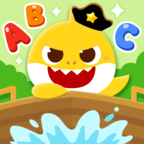

<!-- HEADER_START -->
#  Baby Shark English

   

[← All apps](../../README.md#apps)&nbsp;&nbsp;•&nbsp;&nbsp;`kr.co.smartstudy.bbsenglish_android_googlemarket`&nbsp;&nbsp;•&nbsp;&nbsp;[v3.8.0](https://github.com/xhyxfxxc/lynx-patches/releases/tag/v3.8.0)

**🎯 Supported versions:** `2.48`
<!-- HEADER_END -->

## Features

| Feature | What you get |
|---|---|
| 🚫 **No ads** | Banners, full-screen ads and app-open ads never load. The game is told, like any ad network would tell it, that there is no ad to show. |
| 🎁 **Instant rewards** | A button that offers a bonus for watching a video gives the bonus straight away. No video plays: the game is told the video was watched to the end. |

The patches only touch ads: billing and the Pinkfong membership (the paid subscription) are left exactly as they were, and nothing paid is unlocked.

**Where Lynx Patches lives:** the game has no settings page that a patch can add a row to. Long press the Baby Shark English icon on your home screen and choose Lynx Patches.

## How-to

### Patch the game

1. Download the **XAPK** of version 2.48 (the Google Play release: the base APK plus its splits).
2. Patch it with Morphe and keep **Hide ads (Pinkfong)** and **Skip rewarded ads (Pinkfong)** ticked (on by default).
3. Install the result.

## What to expect

- **Ads are blocked before they are requested.** Each kind of full-screen ad is loaded by one call in Google's ad code, and banners by the game's ad view. Every one of those is answered with "no ad available" straight away (or simply not started), so no request reaches Google AdMob and the ad networks behind it are never asked either.
- **Rewards come without a video.** The game is told an ad loaded, then that it was shown, the reward was earned and it was closed, so it gives the reward at once. Untick **Skip rewarded ads (Pinkfong)** when patching to leave those buttons as they were; with Hide ads on they then find no video and give no bonus.
- **The More apps button stays.** It is Pinkfong's own list of its games, not an ad network, so the patch leaves it as it is.
- **A game update can break it.** The patches are written for version 2.48. Another version is offered as experimental and is checked when you patch.

## FAQ

**Does this unlock the Pinkfong membership or paid content?**
No. Billing and the membership are not touched. The patches remove ads and skip the reward videos only.

**Which file do I download?**
The **XAPK** for version 2.48.

## Patches

<!-- PATCHES_START -->
| 💊&nbsp;Patch | 📜&nbsp;Description | ⚙️&nbsp;Options |
|---|---|---|
| **Hide ads (Pinkfong)** | Removes the ads of Pinkfong and Baby Shark kids games (Google AdMob with Unity Ads and Liftoff): banners, full-screen ads and app-open ads never load. |  |
| **Skip rewarded ads (Pinkfong)** | Gives the reward of a "watch a video" button straight away, without playing an ad: the game is told the ad was watched to the end. |  |
<!-- PATCHES_END -->
